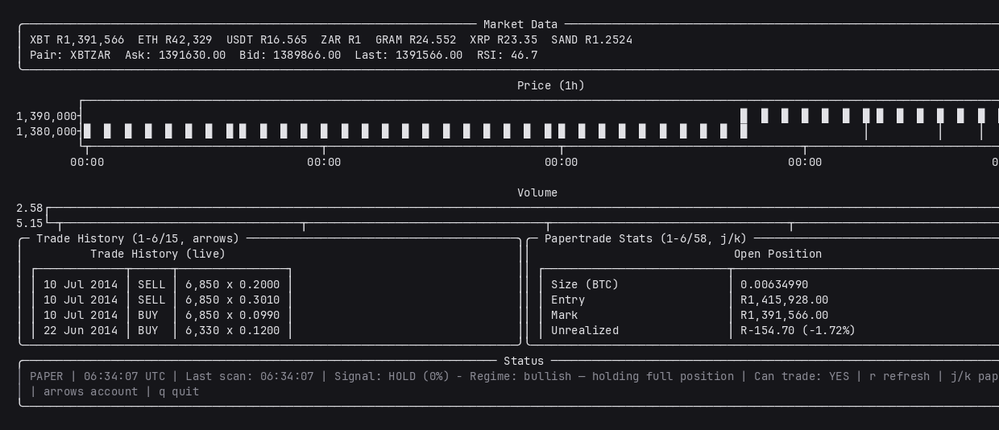

# crypto-backtest-harness

A paper-trading research harness for Luno's ZAR markets, and an honest record
of what was searched for and what was found.



> ## ⚠️ The headline finding: no edge
>
> **No out-of-sample edge was found in SMA/EMA crossovers or Donchian
> breakouts across 16 Luno ZAR pairs.** The strategy family that this repo was
> originally built around does not work, and the evidence is checked into the
> test suite so it cannot be quietly forgotten.
>
> ```
> 704 backtests: 44 parameter combinations × 16 pairs
> XBTZAR daily bars 2013-04-13 → 2026-10-11 (4930 bars), 15 other pairs
> Walk-forward: beat buy & hold on 4 of 8 pairs        ← a coin flip
> Drawdown "edge": 8/8 pairs, but only 43% time in market
>   → normalised by exposure, it INVERTS: 3/8 better, 5/8 worse
> Signal quality: held bars were WORSE than avoided bars on 14/16 pairs (z = −3.00)
> ```
>
> Reproduce:
> ```
> .venv/bin/python test_edge_finding.py     # the conclusion, as an executable test
> .venv/bin/python research.py pairs        # train/test split, all 16 pairs
> .venv/bin/python research.py walk         # walk-forward, pure out-of-sample
> .venv/bin/python exposure.py              # held-vs-avoided bars
> ```

### Eight more families, also no edge

Research continued past the crossovers. **8 families evaluated, none survived.**

| Family | Result |
|---|---|
| Cross-sectional momentum (16 pairs) | 0/18 beat buy & hold *and* the basket |
| Cross-sectional reversal | 0/18 |
| Volatility-target sizing | 0/9 beat plain equal-weight |
| Long-only RSI dip buying | dominated by buy & hold |
| Calendar effects | real effect, **not predictive**, untradable |
| Market-neutral pairs trading | **impossible** — spot-only venue |
| Funding-rate / basis carry | **impossible** — no perpetuals on Luno |

Two facts from [Luno's fee page](https://guide.luno.com/hc/en-gb/articles/14158595648541-Luno-fees-and-limits-in-South-Africa)
bound all of it:

- **Luno is spot-only.** No margin, no leverage, no shorting. Every
  market-neutral construction — long one leg, short the other — cannot be
  executed here at all.
- **The crypto/ZAR taker fee is 0.60% at tier 1**, i.e. **1.30% per round
  trip** and 14.4%/yr for monthly rebalancing. `research.py` originally
  assumed 0.10% — six times too kind, so earlier results here were flattered.

The one genuinely interesting finding: the **06:00 UTC** bar is 08:00 in
South Africa, when the local cash market opens and RSA flow hits Luno. It
replicated out of sample — best hour on train 2013–2021 (+0.1202%), still
best on test 2021–2026 (+0.0586%, t=+4.36, surviving Bonferroni across 24
buckets). It is still worthless: it does **not** predict
(`corr(hour-6, next 24h) = +0.0224`; only volatility persists, not direction),
and a 0.096%/hour effect is dwarfed by a 1.30% round trip.

```
.venv/bin/python crosspair.py        # cross-sectional, at real Luno fees
.venv/bin/python calendar_oos.py     # the 06:00 UTC effect, train/test split
.venv/bin/python calendar_predict.py # ...and why it still can't be traded
.venv/bin/python test_cross_family_findings.py   # all of it, as a test
```

---

## PAPER TRADING ONLY

**This bot never places a real order.** There is no order-placement code
anywhere in the repo — `client.py` is read-only by construction, and `grep` for
`place_order|post_order|create_order` returns nothing. All execution goes
through `PaperTrader`, an in-memory simulator. Do not add live order placement
to this repo without reading the finding above first.

## Install and run

```bash
python -m venv .venv && .venv/bin/pip install -r requirements.txt
cp .env.example .env          # then fill in Luno_API_KEY_ID / LUNO_API_SECRET
.venv/bin/python main.py      # paper-trading TUI
```

Credentials are read from `.env` / environment only and are **never**
committed — `.env` is gitignored and `.env.example` holds placeholders.

### Tests

```bash
.venv/bin/python test_research.py           # research-engine correctness
.venv/bin/python test_edge_finding.py       # THE FINDING, as a test
.venv/bin/python test_crosspair.py          # multi-asset portfolio accounting
.venv/bin/python test_cross_family_findings.py  # 8 families, no edge
.venv/bin/python test_backtest_harness.py   # backtest harness regressions
.venv/bin/python test_backtest_honesty.py   # vault/verdict honesty guards
.venv/bin/python test_papertrade.py         # fill, fee, cooldown logic
.venv/bin/python test_vault.py              # vault accounting
```

### Backtesting and research

```bash
.venv/bin/python backtest.py --candles 86400 --sma-regime
.venv/bin/python backtest.py pairs …       # see research.py --help
```

---

## The backtester refuses to print a verdict below 30 trades

This is deliberate. `backtest.py` will print:

```
VERDICT: NO VERDICT -- n=12 trades, below the 30 needed to distinguish skill from luck
```

The reason this matters: the previous headline was **"VERDICT: BEATS
buy-and-hold" at +74343%**, on **12 trades**, with a Sharpe of **0.36** that the
harness itself labelled "not significant." Separating the vault from strategy
return shows what was really happening:

```
Strategy only:  R100,000 → R69,066     (−30.93%)    ← the actual trading result
+ vault (BTC):  R74,374,500                        ← BTC bought with profits, held since 2013
Buy & hold:     R100,000 → R66,190,476 (+66,090%)
```

The vault was **99.91%** of final equity. It was "I was long BTC in 2014," not
alpha. `backtest.py` now reports strategy-only return as the headline, shows
the vault separately, and refuses to call a result significant below 30 trades.

## Why buy & hold is the right benchmark

Beating buy & hold on an asset that rose 66,000% over 13 years is not evidence
of skill — most of that is ZAR devaluing against BTC. Buy & hold's own Sharpe
on XBTZAR daily is ~1.06. All comparisons here are risk-adjusted (Sharpe,
Sortino, max drawdown, Calmar, time-in-market) on a **fixed daily periodicity**
and the **same window** as the strategy, with spread and fees charged to both.

## Files

| File | What it does |
|---|---|
| `main.py` | Paper-trading TUI: chart, portfolio, risk, governor panels |
| `client.py` | Read-only Luno REST client (tickers, candles, balances, order book) |
| `config.py` | Dataclass config; credentials from env only |
| `paper_trader.py` | Simulated fills, fees, position state, profit-to-vault sweep |
| `strategy.py` | Signal generation: rules, regime, LLM-optional, order-book note |
| `indicators.py` | RSI, EMA, MACD, SMA |
| `risk_manager.py` | Circuit breakers: daily loss, drawdown, consecutive-loss cooldown |
| `governance.py` | Self-adjusting governance params; rules-based or LLM reflection |
| `backtest.py` | Backtest CLI; honest headline + significance-guarded verdict |
| `research.py` | Causal research engine: signals, simulator, risk-adjusted metrics, walk-forward |
| `stress.py` | Stress tests vs buy&hold / DCA / constant-fraction nulls |
| `exposure.py` | Separates "edge" from "was flat more often" |
| `crosspair.py` | Cross-sectional research across pairs, at Luno's real 0.60% fee |
| `candidates.py` | Volatility targeting, calendar effects, dip buying |
| `calendar_oos.py` | The 06:00 UTC effect, split train/test |
| `calendar_predict.py` | Why that effect still can't be traded |
| `validate_engine.py` | Power curve, nulls, overfitting gap — measures the instrument |
| `kronos.py` | Optional external forecast client (off by default) |
| `performance.py` | Trade-level metrics |
| `candles/` | Cached OHLCV per pair+duration (gitignored) |

## Research-engine guarantees

`research.py` is built so its numbers mean something:

- **Causal.** Every weight is decided from bars `< i` and executed at bar `i`'s
  open. Proven in `test_research.py` by deleting future bars and confirming
  weights are unchanged.
- **No vault.** Equity is strictly the traded account.
- **Costs always paid.** Half-spread + 0.1% fee on every fill, strategy *and*
  baselines.
- **Chronological split.** Parameters chosen on train, reported on test.
- **Combination count is printed.** A winner after 200 tries is noise.

## What would change this conclusion

This proves only that *this family of rules, on this data, out of sample, on
these pairs*, does not work. It does **not** prove crypto markets are
inefficient or that no strategy can work. If a future candidate beats buy &
hold on ≥60% of pairs out-of-sample **and** survives drawdown normalisation by
time-in-market, `test_edge_finding.py` will fail — and that failure is the
signal to re-evaluate, not a bug to silence.

## How the negative result was validated

Several bugs were found while building this (equity counted twice, fees
charged as absolute amounts, a tautological t-stat). All of them were
**inflating** — they made results too good, and announced themselves as absurd
numbers. A bug that *suppresses* an edge produces a plausible mediocre curve
and nobody notices, so "found no edge" is the claim most exposed to errors
that were never caught.

Rather than trust the code by inspection, the instrument itself was measured:

| Check | Question | Result |
|---|---|---|
| **Power curve** | Can it find an edge that *is* there? | **Yes** — Sharpe +0.19 → +4.02 as planted signal rises |
| **Null** | Does it invent money on zero-drift data? | **No** — −0.11 Sharpe (costs) |
| **Timing null** | Does timing beat riding drift at random? | **No** — real +0.658 vs shuffled control +0.710 |
| **Overfitting gap** | What is peeking at test worth? | **+0.64 Sharpe** — oracle +0.61, honest −0.03 |

The overfitting row is the one worth reading twice: choosing the best spec
*after* seeing the test segment makes 15 of 16 pairs beat buy & hold. Choosing
it honestly, on train, makes 7 of 16 do — and the mean excess Sharpe goes from
+0.61 to **−0.03**. That gap is exactly the illusion the rest of this repo
exists to remove.

```
.venv/bin/python validate_engine.py         # all four experiments
.venv/bin/python test_engine_validation.py  # them, as assertions
```

**The calibrated claim is therefore: no edge was detectable above this
harness's noise floor** — not the stronger "no edge exists." The power curve
shows detection needs roughly `drift/vol ≥ 0.2`; an effect weaker than that is
simply invisible here, in either direction.